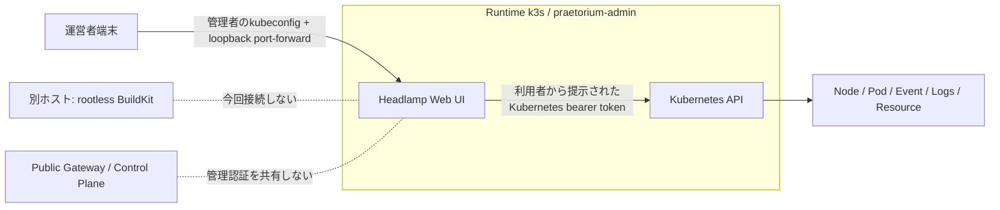

# Praetorium — 管理者インターフェースと運用統合アーキテクチャ

**状態:** オーナー合意を起点とする設計。第1段階のHeadlampアドオンのみ実装対象。  
**基準:** `main@11830bc9d481754c3f2932639ea074f27d2a6889`（実行時のHEADは再取得する）。  
**上位契約:** 最新のオーナー指示、[Epic #1](https://github.com/yohn-jp/praetorium/issues/1)、[既存責務台帳](SYSTEM.md)。  
**禁止:** テナントControl Planeへのインフラ管理権限追加、管理用の新しい汎用Plane実装、独立した状態正本の複製、既存の運用フェンス迂回。

## 1. 決定事項と目的

Praetoriumの運営者は、k3sだけではなくRuntime/Builder/Workers/D1/KV/OCI Registryを含む**プラットフォーム全体**の状態・配置・障害を管理する。そのためのPraetorium Adminは、将来各プロバイダに特化した既存OSS管理UI/監視機能を一つの入口から利用できるようにする**運用の入口**であって、別のオーケストレータや状態管理Planeではない。

管理者の運用操作を、一般のGitHubユーザーが利用するGateway/Control Planeへ集約しない。インフラ固有の観測はそのプロバイダのAPI/既存ツールから取得する。プロダクト固有の状態遷移が必要な場合に限り、既存の正本・CAS/lease/epoch/one-writer契約に従う管理操作を設ける（D1やKubernetesへの手動パッチで代替しない）。

本PRは**Runtime管理UIの第1段階**だけを実装する。Headlampを既存のRuntime k3s内に独立サービスとして設置可能にし、当面は管理端末のローカルポートフォワードから利用する。Praetorium Adminの共通ポータル、Builder/Cloudflare管理画面、SSO、公開ホストやiframeは**作らない**。

## 2. 管理する対象と正本

| 管理領域 | 真実の所在 / 既存API | 第1段階 | 将来のPraetorium管理入口 |
| --- | --- | --- | --- |
| Runtime / k3s | Kubernetes APIのNode/Pod/Deployment/Events/Logs/Capacity | Headlampの既存UIで観測・RBAC許可範囲の操作 | 独立認証の管理用UIから別originへ遷移/埋め込み |
| Scriptorium Instances | D1のDesired/Operation/Artifact、k3sのObserved、GitHubの原稿 | 既存経路を維持 | インスタンス別状態の集約。操作は正規のフェンス付きAPI |
| Builder / BuildKit | Build VMのBuildKit daemon/cache/disk、Build Worker実行状態 | 変更なし | 独立のBuilder観測アダプタ。任意ビルド機能は作らない |
| Cloudflare Workers | Cloudflare Worker/Deploy/analytics | 変更なし | 既存Cloudflare管理API/UIを利用 |
| D1 / KV / DO | Cloudflareの管理API、D1/KVの実データと指標 | 変更なし | 使用量/運用状態の参照。D1直接書換は原則しない |
| OCI/GHCR | RegistryのDigest固定アーティファクト | 変更なし | BuildKey/Release/Artifactの参照情報とRegistry状況 |

**境界:** HeadlampはPod/Nodeの生存と診断を扱う。特定のPodを直接Deleteできる権限があっても、それはPraetoriumの安全なインスタンス停止・Drain・置換を意味しない。OperatorはテナントRuntimeの削除・再作成・Route変更をHeadlampの任意操作で実施せず、既存のProvisionerの正規ライフサイクルを用いる。

## 3. 初期実装 — Headlampの位置づけ



- **配備:** HelmRepository + HelmRelease（公開済みChart `headlamp/0.45.0`）、独立Namespace `praetorium-admin`。既存FluxのHelm Controllerを再利用し、通常の`deploy-k3s`や本番静的Platform Bundleには**自動追加しない**。
- **認証:** HeadlampはKubernetes bearer tokenの本人認可をKubernetes RBACへ委譲する。OIDCは将来の管理入口で別途決める。PraetoriumのGitHub利用者セッションやGateway鍵を流用しない。
- **権限:** Helm Chartの既定では`clusterRoleBinding.create: true`かつ`cluster-admin`なので**明示的にfalse**にする。Headlamp Pod ServiceAccountはAPIへの接続情報を使うためTokenをmountするが、アプリPodにはClusterRoleBindingを付与しない。管理者の実権限は別途レビューされた認証主体・Role/ClusterRoleBindingにのみ設定する。
- **公開:** `ClusterIP`のみ。`Ingress`、`HTTPRoute`、`NodePort`、`LoadBalancer`、外部DNS、TLS証明書は生成しない。管理端末の`127.0.0.1`ポートフォワードだけを初期導線とする。Namespace内への流入はNetworkPolicyで拒否し、明示的に管理用入口を作るまで通常のPod経由アクセスは許可しない。
- **Pod安全性:** `restricted` Pod Security、非root、read-only root filesystem、drop ALL、seccomp RuntimeDefault、権限昇格不可。Helm操作・プラグイン自動管理・実験的クラスタInventoryは無効。
- **稼働上限:** 1 replica、小さいCPU/メモリrequestsと明示的limits。Headlamp固有のDB、永続PVC、定期Cloudflare Workerリクエストを追加しない。
- **冗長化/復旧:** Clusterそのものが故障した場合、Headlampもアクセスできなくなる。Host運用・`kubectl`はbreak-glass手段として残す。HeadlampをKubernetes制御の正本にしない。

## 4. 将来のPraetorium Adminへの組み込み方針

当面のHeadlampは独立アプリとして完成させる。将来は別の管理者専用origin（例示でありDNS確定ではない）からリンクを張り、要求が明確ならiframeやサブパスを評価する。

- 管理用アプリとHeadlampは**別origin**を原則とし、一般利用者向けGateway Cookie、GitHub App秘密鍵、D1操作トークンを渡さない。
- 埋め込み前にHeadlampのCSP `frame-ancestors`、CookieのSameSite/Secure、ブラウザ同一生成元制約、WebSocket、OIDCリダイレクト、サブパス配信の挙動を実機で確認する。認証情報のURLクエリ引き渡しや無制限のreverse proxyは行わない。
- Admin画面の将来のメニューはPlatform/Runtime/Builder/Workers/Storage/Instances/Operationsを想定するが、本PRではUIメニュー、管理API、運用操作の抽象化を新設しない。
- Runtime以外の管理UIは、当該プロバイダの運用要件と権限を個別に検証して選定する。HeadlampがBuildKitやD1を管理できるとは扱わない。

## 5. 導入 / 検証 / ロールバック

マニフェスト: [`infrastructure/kubernetes/addons/headlamp/`](../../infrastructure/kubernetes/addons/headlamp/) 。既存のFlux/Helm ControllerがReadyであることを前提とする。

**必ず運営者が所有するkubeconfigと明示的contextを指定し、Nodeの`praetorium.io/cluster-id`を既存の承認済みDeployment Inventoryに照合した後に実施する。** 次のコマンドは手順の例であり、このPRでは実行しない。

```sh
export KUBECONFIG=/absolute/private/kubeconfig
CTX=praetorium-runtime # 運営者がInventoryから取得する値
kubectl --context "$CTX" get nodes --show-labels
kubectl --context "$CTX" kustomize infrastructure/kubernetes/addons/headlamp
kubectl --context "$CTX" apply --dry-run=client -k infrastructure/kubernetes/addons/headlamp
# 本番適用は別途承認後に限定:
kubectl --context "$CTX" apply -k infrastructure/kubernetes/addons/headlamp
kubectl --context "$CTX" -n flux-system wait --for=condition=Ready helmrelease/praetorium-headlamp --timeout=300s
kubectl --context "$CTX" -n praetorium-admin rollout status deploy/praetorium-headlamp --timeout=300s
kubectl --context "$CTX" -n praetorium-admin port-forward --address 127.0.0.1 svc/praetorium-headlamp 8080:80
# 管理端末のブラウザで http://127.0.0.1:8080 にアクセス
```

- Headlampのログインには**既存の許可済み管理者の短命Kubernetes Token**等を使用し、その認可範囲が`kubectl auth can-i`で一致することを確認する。管理者向けClusterRoleBindingをこのアドオンが勝手に生成することはない。
- 導入検証: Namespaceの`restricted`、Headlamp Deployment/ServiceのReady、`ClusterIP`のみ、Ingress/NodePort/ClusterRoleBindingが追加されないこと、未認証のKubernetes操作が拒否されること、明示的なRBAC権限内のNode/Pod/Events/Logsだけが見えることを確認する。
- レンダー/CI検証と実クラスタ受入は異なる。対象Cluster、Chart版、リソースUID、RBACの実結果がない限り「本番配備済み」と報告しない。
- Rollbackは同じ明示的contextで`kubectl delete -k infrastructure/kubernetes/addons/headlamp`（**このアドオンのNamespace/HelmRelease/HelmRepository/NetworkPolicyだけ**）とし、テナントNamespaceや既存のFlux Controllerには触れない。意図した場合以外は実行しない。

## 6. 残すべき判断と非ゴール

| テーマ | このPRの扱い |
| --- | --- |
| 独立Admin Consoleの認証/OIDC | 未選定。利用者Gatewayとの分離だけを確定 |
| 公開管理用domain/Ingress/VPN | 未設定。安全な公開入口が決まるまでポートフォワード |
| 運用特権とBreak-glass | アドオンに自動的なcluster-admin付与なし。既存管理権限のレビューは運用者責務 |
| Builder / D1 / KV / Worker統合 | 別フェーズの設計対象。本PRはHeadlampのRuntime観測/管理基盤のみ |
| PraetoriumテナントのInstance操作 | 既存のD1・Provisionerを使用。HeadlampのPod直接操作で代替しない |
| Hosted G1–G9 | このアドオンは製品のG1–G9の完成認定を変更しない |
| 本番apply / domain公開 | このPRでは実施禁止 |

## 7. 参照

- [Headlamp公式 Helm Chart 0.45.0](https://github.com/kubernetes-sigs/headlamp/tree/headlamp-helm-0.45.0/charts/headlamp)（Apache-2.0）
- [Headlamp in-clusterインストール](https://headlamp.dev/docs/latest/installation/in-cluster/)
- [Headlamp認証とRBAC](https://headlamp.dev/docs/latest/installation/)
- [既存Praetorium責務分離](SYSTEM.md)
