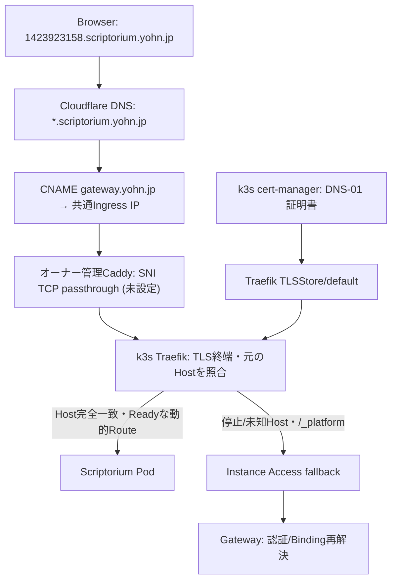
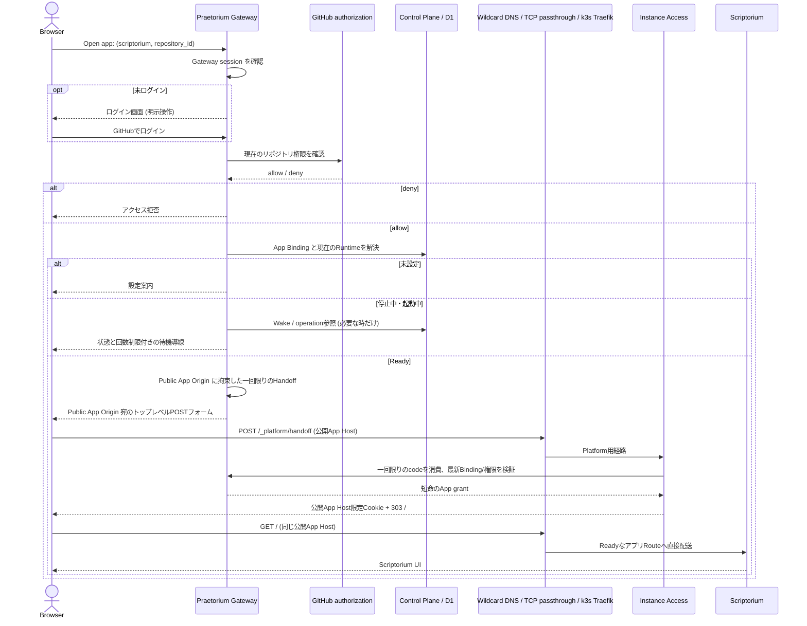
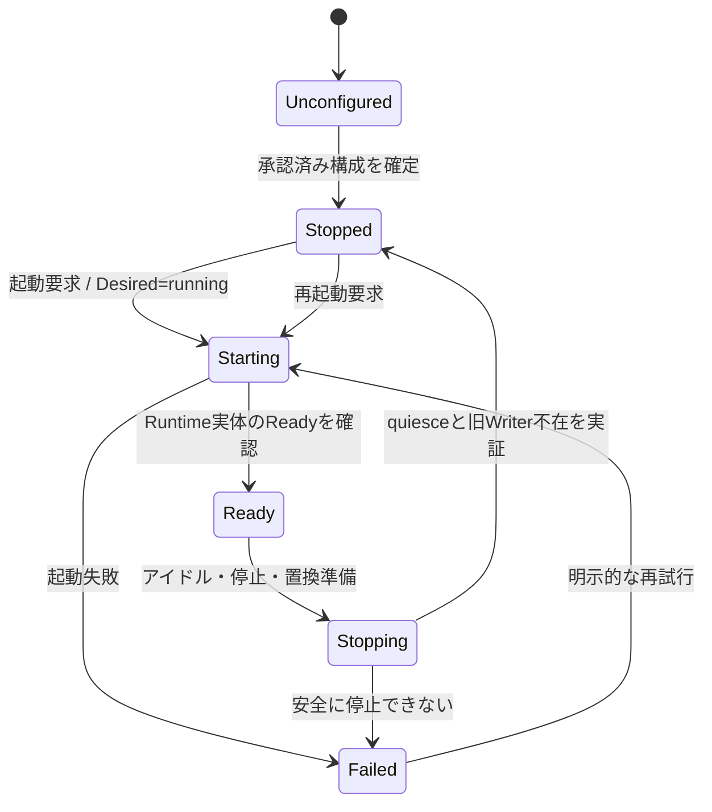
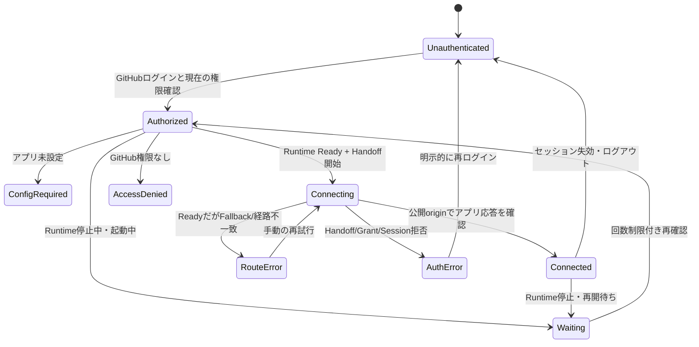

# Praetorium — アプリケーション公開URL・Runtime識別子・画面遷移

> **状態:** 2026-10-20 の最新オーナー決定で公開DNSとTLS終端を更新。URL・Runtime同一性は継続、**実K3sへの適用とHTTPS疎通は未検証**。  
> **Authority:** [Issue #18](https://github.com/yohn-jp/praetorium/issues/18) およびオーナーの最新指示。従前の [Epic #1](https://github.com/yohn-jp/praetorium/issues/1) の単一Writer・現在権限の再検証・保存/復旧要件は維持し、識別子の意味が衝突する部分だけ今回の決定を優先する。  
> **調査基準:** `yohn-jp/praetorium@cc726923816e89dc106fae33a71c415b410cdd4b`。現状の責務は [SYSTEM.md](SYSTEM.md)、実コード経路は [EXECUTION.md](EXECUTION.md)。  
> **この文書のスコープ:** URL・DNS・k3sでの証明書管理・Origin・アプリ/Runtime同一性・状態遷移の契約。Better Auth採否やUI改訂は別途決定する。

## 1. 製品境界と識別子

**Praetoriumは、GitHubリポジトリのユーザー権限を利用してアプリケーションを実行・管理する基盤**であり、Scriptorium固有のアプリケーションではない。Scriptoriumは最初の利用アプリケーション。将来の別アプリも同じ基盤を利用できるが、この決定は任意アプリのインストール/汎用PaaS化を許可しない。

| 概念 | 正本と役割 | 生存期間・公開可否 |
| --- | --- | --- |
| `app_identity` | プラットフォームが登録するアプリ種別のDNS安全な識別名。初期値は `scriptorium`。 | アプリ種別に固定。利用者入力やリポジトリ名から導出しない。 |
| `application_id` | **GitHub numeric `repository_id`**。当該アプリにおける論理的な利用単位。 | リポジトリに対して安定。GitHubのowner/name変更で変えない。 |
| `application_binding` | キー `(app_identity, repository_id)`。アプリ設定、アクセス判断、現在のRuntimeへのポインタを持つ論理的な関係。 | Runtimeの停止・再作成をまたいで安定。現在の権限判断はGitHub Appが正本。 |
| `instance_id` | **ある一つの具体的なRuntime/コンテナ実体の絶対識別子**。別の実体に再利用しない。 | Runtime置換時は新しいID。ユーザーのアプリIDやログインセッションIDではない。 |
| `runtime_epoch` / generation | 実行世代・CAS・Writerフェンシングのための状態。 | インスタンス識別子と別。番号だけで旧Writerが死亡したとはみなさない。 |
| `session_id` | GitHubログインを経たブラウザ認証セッション。 | 短命/失効可能。**URLを構成しない**。 |

公開Appの不変キーは `(app_identity, repository_id)` である。同じリポジトリが将来複数アプリ種別を利用しても、App間でコンテナやブラウザCookieを共用しない。初期実装はScriptoriumのみでよい。

**重要な現状差分:** 現行 `instance_id` は `ins_<ULID>` 形式の**論理的なリポジトリ単位のID**で、`runtime_epoch` によって実行世代を識別する。この正本をそのまま「物理コンテナの絶対ID」と読み替えてはいけない。目標では論理 `application_binding` と物理 `instance_id` を分割する。Kubernetes Pod UIDやコンテナランタイムの生IDと同一だと推定せず、一つのRuntime実体に拘束されるIDとして検証可能にする。

## 2. 公開URL・静的ワイルドカードDNS・k3s TLS

**2026-10-20の最新オーナー決定:** リポジトリ別のDNSレコードは作らない。DNSはすべてのScriptoriumアプリを共通Ingressへ向け、Praetorium/K3sが元のHTTP Hostから現在のRuntimeを選択する。K3sのcert-managerが証明書を発行・更新し、TraefikがTLS終端する。Caddyは後日オーナーが**TLSを終端せずTCP/SNIを透過転送する**。

| 役割 | FQDN / URL | 更新の単位 |
| --- | --- | --- |
| Praetorium管理ポータル | `https://praetorium.yohn.jp` | 基本不変 |
| Scriptorium公開アプリ | `https://[repository_id].scriptorium.yohn.jp` | リポジトリに対して不変 |
| 汎用の公開アプリ規則 | `https://[repository_id].[app_identity].yohn.jp` | アプリ種別ごと（現在はScriptoriumのみ） |
| 物理Runtimeホスト識別 | `[id].instances.praetorium.yohn.jp` | Runtime世代ごと（**ins- DNS接頭辞なし**） |

公開DNSはCloudflareの**単一のDNS-onlyワイルドカードレコード**:

```dns
*.scriptorium.yohn.jp. CNAME gateway.yohn.jp.
```

- `gateway.yohn.jp` はオーナーが管理する共通公開IngressのDNS名であり、PraetoriumのGateway Workerではない。DNS先のIP変更にも追従する。
- 個々の `[repository_id].scriptorium.yohn.jp` を `[id].instances.praetorium.yohn.jp` へCNAMEで直接結び付け**ない**。その旧方式は廃止した。リポジトリ作成・Runtime置換・停止でCloudflare DNS APIを呼ばない。
- `*.scriptorium.yohn.jp` と `*.instances.praetorium.yohn.jp` は別の名前空間。内部の物理Runtime IDはDNSによるアプリの認可/到達先決定には使わない。
- CNAMEはHTTP HostやTLS SNIを変更しない。公開ホスト `[repository_id].scriptorium.yohn.jp` を保持したままTraefikへ到達させる。



### k3s内での証明書発行と選択

- `infrastructure/kubernetes/overlays/deployment/tls.yaml` の `ClusterIssuer/praetorium-acme` がCloudflare DNS-01を利用。APIトークンは**cert-manager namespace**のSecretに置き、Gitへ格納しない。
- `Certificate/praetorium-instance-origin` は `praetorium-system` に作成され、`*.scriptorium.yohn.jp` および既存の物理インスタンス用SANを含む。単一のSecret `@@TLS_SECRET_NAME@@`（デプロイInventory値）を更新する。
- `infrastructure/kubernetes/base/tls-store.yaml` の**唯一の `TLSStore/default`** がその同Namespace Secretを参照する。TraefikのCRD providerは `defaultTLSResourcesNamespace=praetorium-system` に固定。別Namespaceの動的テナントIngressRouteは `tls: {}` のまま、このグローバルdefault storeの証明書を使う。
- 固定のInstance Access fallbackは自身と同じNamespaceのSecretを参照する。独立の `*.scriptorium` 証明書をテナントごとに発行したり、他NamespaceのSecretを参照させたりしない。
- **オーナー管理Caddyでは証明書を発行せずHTTP Reverse ProxyのTLS終端も行わない。** TCP/SNIパススルーにはCaddyの標準HTTPサイトブロックではなく、対応するLayer 4機能または同等のTCP Proxyが必要。未構成なら公開HTTPSは未完成であり、DNSとK3sのCertificate Readyだけではブラウザ接続を認証しない。

このPRはDNS・Caddy・cert-manager Secret・稼働K3sを変更しない。Cloudflareで既に設定したワイルドカードCNAMEの状態は外部運用の正本であり、アーキテクチャ文書は適用済み環境の証明にはならない。

## 3. ブラウザの正常な画面遷移

**利用者が見るURLはPraetorium管理画面と公開アプリURLの二つ**。起動中の内部 `instance_id` はリンクに露出させない。認証の実装にBetter Auth等を選ぶかどうかは別問題であり、現行の認証境界を保つ。



Handoffコード、Grant、CSRF、Cookie、JWTの `aud` / `origin`、CSP `form-action` は公開Appの**完全一致origin**へ拘束する。GitHub Appの資格情報、Handoffコード、作業本文をURLクエリ・フラグメント・ログへ渡さない。UI/API/MCPの本文通信を一般のGateway Workerで中継しない。

停止中に公開App URLを直接開いた場合もInstance AccessのFallbackからGatewayへ戻し、再認証・権限再検証・起動を行う。任意のPOST本文はバッファして後から再送しない。

## 4. 状態遷移（正本のRuntimeとブラウザの接続を分離）

### 4.1 Runtime／制御状態（Control PlaneとKubernetes）



`Ready` は**Runtimeの観測結果**であり、ブラウザの接続成功ではない。コンテナ置換は既存のquiesce/旧Writer不在/credential retirement/世代フェンスを満たす別実体の割当として扱う。置換時に公開App URLは不変、物理 `instance_id` は更新、静的ワイルドカードDNSは変えずにIngressRouteの切替を行う。Runtime EpochやLeaseの失効のみでは旧Writerを死んだと判定しない。

### 4.2 ブラウザの一時的な接続状態（永続D1正本を新設しない）



`Connecting` / `Connected` / `RouteError` / `AuthError` は**ブラウザ操作の結果**であり、D1へ別の永続状態やセッション単位のインスタンスを追加しない。GatewayがReadyと返しても `GET /` でアプリを表示できなければ `Connected` としない。RouteErrorでは503・原因種別・手動再試行・管理画面リンクを提供し、自動Handoffループは止める。待機状態の自動更新も有界で、未認証時は再認証へ明示的に誘導する。

**デスクトップとモバイルは同じ遷移契約を満たす。** 2026-10-19時点でPCからのScriptorium接続成功とスマートフォンでの失敗がユーザー観測されているが、この文書はスマホ障害の原因特定・修復完了を主張しない。

## 5. 置換、DNS切替、認可の不変条件

1. **論理App Bindingは先に確定する。** 現在の `repository_id → logical instance_id` の保存契約を維持したまま物理IDへ読み替えたり、履歴データを消して移行したことにしない。
2. **次のRuntimeを配置してもWriterを二重化しない。** 旧Writer排除・Quiesce・保存回復・Credential retirement・Epochの既存フェンスを維持する。
3. **RuntimeのRouteをフェンス付きで切り替える。** 新しいService・IngressRouteの存在/疎通を確認し、公開アプリのHostに対する唯一のReady Routeを更新する。共通ワイルドカードDNSは変更しない。失敗時は旧経路へ安全に戻すか、権限保護された停止状態にする。
4. **停止中でも公開App URLを維持する。** 初回の未割当時にはGateway上の設定導線を提供。ワイルドカードDNSにより常に共通Ingressへ解決し、停止/未知のHostは認証付きFallbackへ送り、解放済みRuntimeへアクセスさせない。
5. **Appホストは認可を付与しない。** 公開名にGitHub numeric IDが含まれても、Gatewayセッション・現在のGitHub権限・Binding/Runtime/Grantを毎回適切な境界で検証する。CNAME target、Hostヘッダー、TLS証明書はユーザー権限の代替ではない。
6. **パブリックOriginを保護する。** Scriptorium認証Cookieは `[repository_id].scriptorium.yohn.jp` のHost-only、`Secure`、`HttpOnly` 等の現行保護を引き継ぎ、別アプリや `[id].instances...` へ共有しない。公開アプリ名は一回限りのHandoffとGrantの検証対象と一致させる。

## 6. 実装所有者と切替条件

| 責務 | 所有者・実装箇所 | 現在の契約 |
| --- | --- | --- |
| ログイン、GitHub権限確認、App Binding、Handoff | [Gateway router](../../apps/gateway/src/router.ts) / [Portal Service](../../apps/gateway/src/services/portal-service.ts) | 公開App originに拘束した短命Grantを発行 |
| 論理Binding、Runtime epoch、Writer安全性 | Control Plane / D1 / Provisioner | 同じRepositoryの並行Writerを防止し、旧Writer不在を実証 |
| 物理Runtime名 | [instance-hostname.ts](../../packages/contracts/src/instance-hostname.ts) | `[id].instances.praetorium.yohn.jp`。公開アプリDNSでは参照しない |
| 公開DNS | Cloudflare、オーナー管理 | `*.scriptorium.yohn.jp CNAME gateway.yohn.jp` を1件。ProvisionerはDNSレコードを作成・更新しない |
| 公開TLS | [cert-manager ClusterIssuer/Certificate](../../infrastructure/kubernetes/overlays/deployment/tls.yaml) | DNS-01によるK3s Secret発行・自動更新。Caddyでは発行しない |
| 証明書選択 | [Traefik TLSStore/default](../../infrastructure/kubernetes/base/tls-store.yaml) | `praetorium-system` のSecretを全Namespaceのデフォルトに使用 |
| 公開TCP中継 | オーナー管理Caddy（[運用境界](../../infrastructure/caddy/README.md)） | SNIを保持してTCPを透過転送。今回のPRでは適用しない |
| 動的アプリ経路 | [Kubernetes Renderer](../../plugins/kubernetes/src/kubernetes/renderer.ts) | HTTP HostのRepository IDから、その時のReady Serviceへ |
| 停止中・未配置・プラットフォーム経路 | [Instance Access](../../apps/instance-access/src/handler.ts) | 認証とBounded Wake/Error。POST本文は自動再送しない |

## 7. 受入境界と未検証事項

**この文書で確定:** アプリ公開URL、物理Runtime URL（`ins-` なし）、**静的ワイルドカードCNAME**、k3s cert-manager/TLSStore、論理/物理ID分離、状態遷移、DNS/TLS/HTTP/認証の責務。

**後続の実環境検証:** 現行の論理/物理Bindingの一致、GitHub認可/Handoff、共通DNS解決、オーナー管理CaddyのTCP/SNIパススルー、k3s証明書の実SAN・更新、TraefikのHost一致、旧URL/旧Cookieの安全な扱い、停止中ブックマークとWake、ReadyだがRoute未確立時の503、Runtime置換時の単一Writer、PCとスマホの実ブラウザE2E。

**未実施:** この修正の本番Caddy/Traefik/cert-manager適用とHTTPS実疎通、Better Authの採用、運用セキュリティ検証、スマホ接続障害の原因特定。本書のPRがCIで通っても本番疎通は保証されない。

参考: [Cloudflare CNAMEとレコード種別](https://developers.cloudflare.com/dns/manage-dns-records/reference/dns-record-types/)、[Cloudflare Universal SSL制約](https://developers.cloudflare.com/ssl/edge-certificates/universal-ssl/limitations/)、[CloudflareのワイルドカードDNS](https://developers.cloudflare.com/dns/manage-dns-records/reference/wildcard-dns-records/)。
