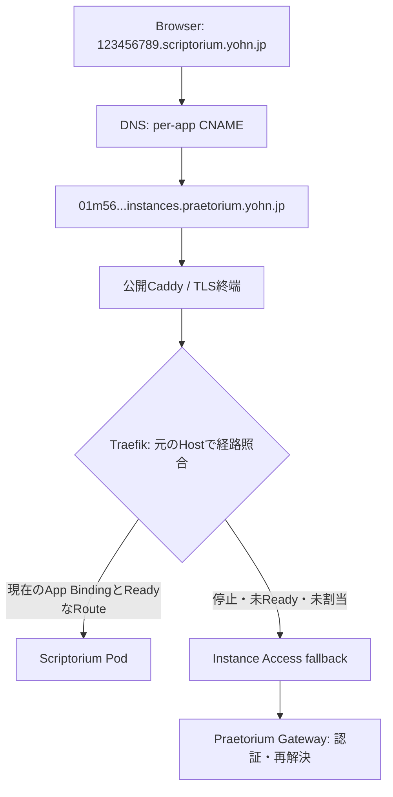
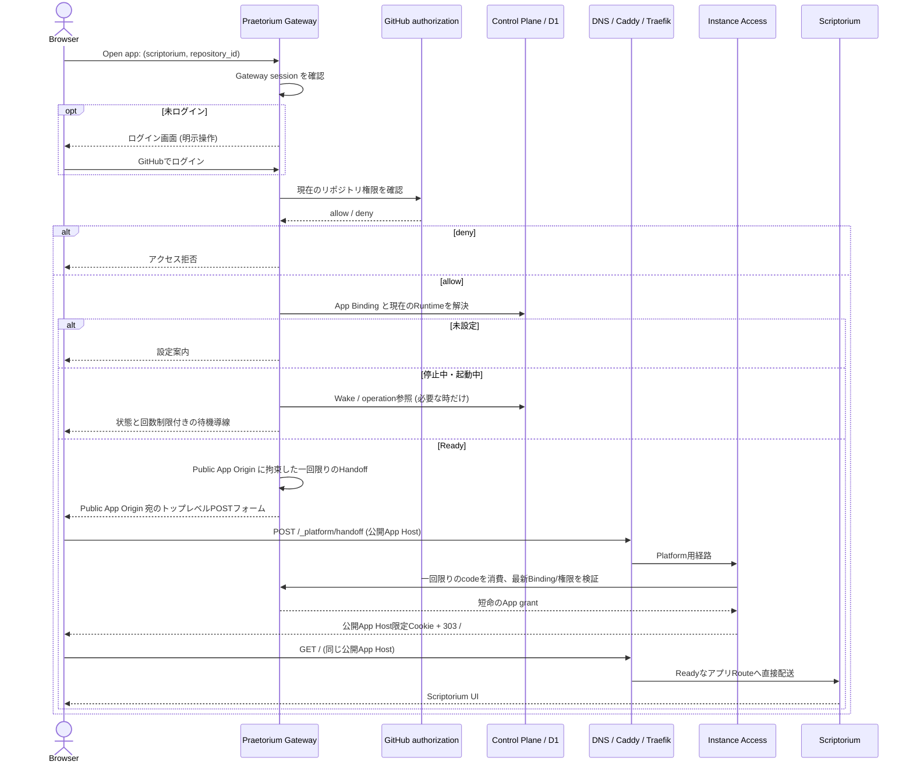
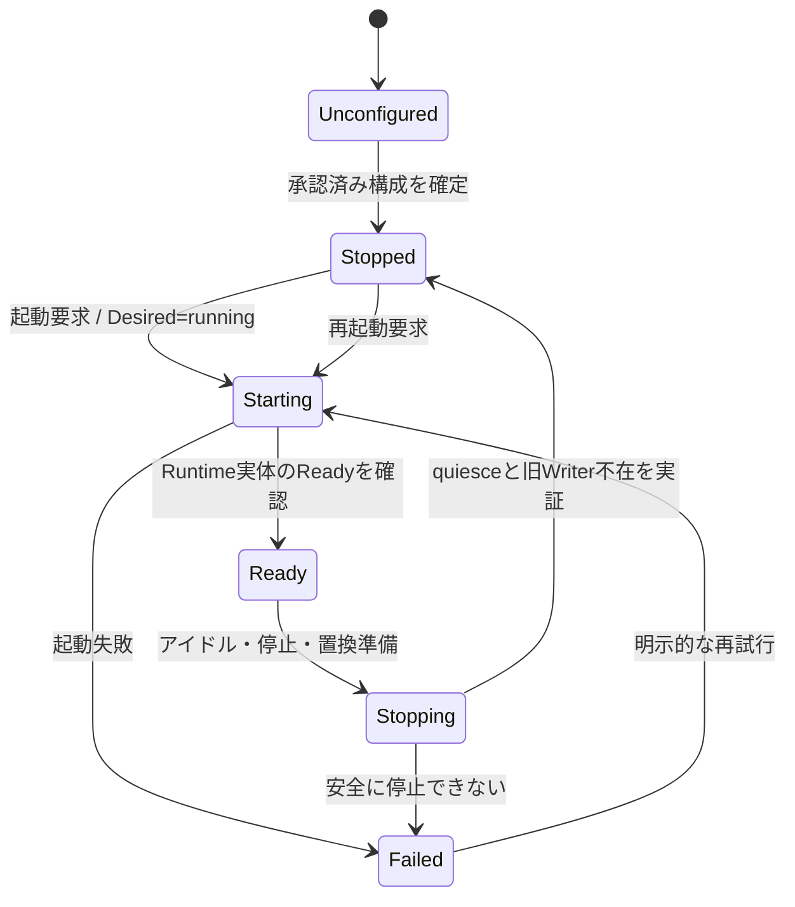
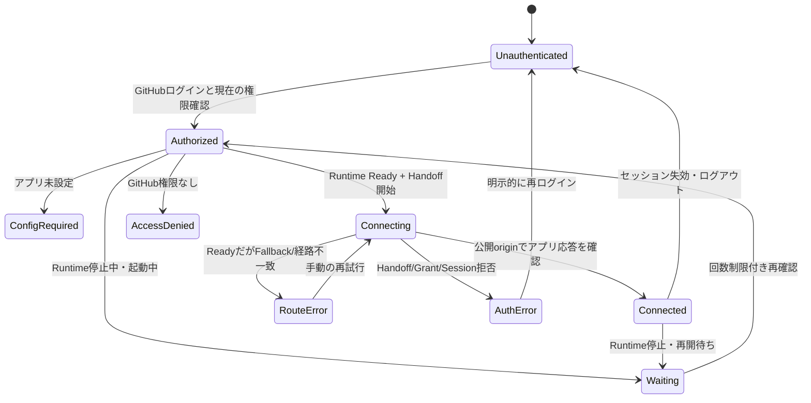

# Praetorium — アプリケーション公開URL・Runtime識別子・画面遷移

> **状態:** 2026-10-19 のオーナー決定を記録した**目標アーキテクチャ**（実装・DNS適用・本番検証は未実施）。  
> **Authority:** [Issue #18](https://github.com/yohn-jp/praetorium/issues/18) およびオーナーの最新指示。従前の [Epic #1](https://github.com/yohn-jp/praetorium/issues/1) の単一Writer・現在権限の再検証・保存/復旧要件は維持し、識別子の意味が衝突する部分だけ今回の決定を優先する。  
> **調査基準:** `yohn-jp/praetorium@cc726923816e89dc106fae33a71c415b410cdd4b`。現状の責務は [SYSTEM.md](SYSTEM.md)、実コード経路は [EXECUTION.md](EXECUTION.md)。  
> **この文書のスコープ:** URL・DNS・Origin・アプリ/Runtime同一性・状態遷移の契約。Better Authの採否、UIのデザイン改訂、インスタンスの実装変更、移行実行は含めない。

## 1. 製品境界と識別子

**Praetoriumは、GitHubリポジトリのユーザー権限を利用してアプリケーションを実行・管理する基盤**であり、Scriptorium固有のアプリケーションではない。Scriptoriumは最初の利用アプリケーション。将来の別アプリも同じ基盤を利用できるが、この決定は任意アプリのインストール/汎用PaaS化を許可しない。

| 概念 | 正本と役割 | 生存期間・公開可否 |
| --- | --- | --- |
| `app_identity` | プラットフォームが登録するアプリ種別のDNS安全な識別名。初期値は `scriptorium`。 | アプリ種別に固定。利用者入力やリポジトリ名から導出しない。 |
| `application_id` | **GitHub numeric `repository_id`**。当該アプリにおける論理的な利用単位。 | リポジトリに対して安定。GitHubのowner/name変更で変えない。 |
| `application_binding` | キー `(app_identity, repository_id)`。アプリ設定、アクセス判断、現在のRuntimeへのポインタを持つ論理的な関係。 | Runtimeの停止・再作成をまたいで安定。現在の権限判断はGitHub Appが正本。 |
| `instance_id` | **ある一つの具体的なRuntime/コンテナ実体の絶対識別子**。別の実体に再利用しない。 | Runtime置換時は新しいID。ユーザーのアプリIDやログインセッションIDではない。 |
| `runtime_epoch` / generation | 実行世代・CAS・Writerフェンシングのための状態。 | インスタンス識別子と別。番号だけで旧Writerが死亡したとはみなさない。 |
| `session_id` | GitHubログインを経たブラウザ認証セッション。 | 短命/失効可能。**URLを構成しない**。 |

公開Appの不変キーは `(app_identity, repository_id)` である。同じリポジトリが将来複数アプリ種別を利用しても、App間でコンテナやブラウザCookieを共用しない。初期実装はScriptoriumのみでよい。

**重要な現状差分:** 現行 `instance_id` は `ins_<ULID>` 形式の**論理的なリポジトリ単位のID**で、`runtime_epoch` によって実行世代を識別する。この正本をそのまま「物理コンテナの絶対ID」と読み替えてはいけない。目標では論理 `application_binding` と物理 `instance_id` を分割する。Kubernetes Pod UIDやコンテナランタイムの生IDと同一だと推定せず、一つのRuntime実体に拘束されるIDとして検証可能にする。

## 2. 確定したURLとDNS

| 役割 | 目標のFQDN / URL | 更新されるタイミング |
| --- | --- | --- |
| Praetorium管理ポータル | `https://praetorium.yohn.jp` | 基本不変 |
| Scriptorium公開アプリ | `https://[repository_id].scriptorium.yohn.jp` | リポジトリに対して不変 |
| 汎用の公開アプリ規則 | `https://[repository_id].[app_identity].yohn.jp` | `app_identity` を登録した時点で固定 |
| Runtime/コンテナ固有の名前 | `[id].instances.praetorium.yohn.jp` | Runtime生成ごとに新しい `id`。**`ins-` ホスト名接頭辞は付けない** |
| 管理側のEntryルート | `https://praetorium.yohn.jp/entry/... ` | アプリ公開URLとは別の制御経路。現状 `/entry/:instanceId` のため移行が必要 |

**CNAMEの規則（各アプリ/各リポジトリの実体ごとに登録）:**

```dns
; app_identity = scriptorium, repository_id = 123456789, id = 01m56estantnhv8ba5j1pcnnqj
123456789.scriptorium.yohn.jp. CNAME 01m56estantnhv8ba5j1pcnnqj.instances.praetorium.yohn.jp.

; 物理ホスト側は既存の instances 名前空間と公開Ingressへ解決する。
; 具体的なA/AAAA/CNAMEやDNS提供者設定はこのPRでは変更しない。
```

- `[id]` はDNSホスト名に使う**小文字でDNS安全な識別ラベル**（例では26桁ULIDのラベル部分）。`ins-` は付けない。旧 `ins_<ULID>` のアプリ内部表現を残すかどうかは別の契約変更で扱う。
- CNAMEの**owner**は `[repository_id].[app_identity].yohn.jp`、**target**はそのときの物理Runtimeを指す `[id].instances.praetorium.yohn.jp`。コンテナ置換ではtargetを更新する。ログイン/ブラウザごとのCNAMEを作らない。
- `*.scriptorium.yohn.jp CNAME *.instances.praetorium.yohn.jp` のようなワイルドカードによるラベル置換は**しない**。リポジトリIDから物理IDを計算できないので、論理Bindingに基づき**個別のCNAME**が必要。
- CNAMEの宛先はDNS上の別名であり、HTTPリダイレクトでもReverse Proxyでもない。DNS TTL、旧参照を保持するResolver、停止時の直リンクを考慮する。新しいRuntime未配置/停止中でも、公開ホストのDNS到達性とFallbackは維持し、アプリへの権限を推定しない。
- 将来の別アプリは `[repository_id].ide.yohn.jp` など、**別の製品名前空間**を利用できる。名前空間を採用する前に `app_identity` をプラットフォーム登録値として一意に管理する。

### DNSとHTTP経路は別



ブラウザのTLS SNIとHTTP `Host` はCNAME先ではなく **`123456789.scriptorium.yohn.jp` のまま**である。IngressRouteで `[id].instances.praetorium.yohn.jp` だけを許可しても、公開アプリURLは開かない。

- Caddyは **`*.scriptorium.yohn.jp`** に一致する有効な証明書とHostを処理する。既存の `*.instances.praetorium.yohn.jp` 証明書では代用できない。複数階層の `*.scriptorium.yohn.jp` はCloudflareの通常のUniversal SSL範囲外なので、既存公開TLS終端での明示的な発行/更新（必要ならDNS-01）を別途確認する。
- Traefikは**元の公開Appホスト**を識別して、現在の `(app_identity, repository_id) → instance_id → Service` に紐づける必要がある。単なるCNAME書換では切り替わらない。静的 `/_platform/*` と停止時Fallbackの優先順位は維持する。
- Instance Accessは従来の「`ins-` ホスト名からinstanceIdを復元する」方式だけでは足りない。公開Appホストから正規Bindingを解決し、Gatewayで現在のGitHubユーザー権限・Runtime Epochを再確認する。ホスト名やCNAMEを認可証明として信用しない。
- `[id].instances.praetorium.yohn.jp` は物理配置に関するプラットフォームの名前であり、利用者向けの別セッションを発行する入口にはしない。直接呼ばれても公開App側のホスト限定Cookie・Grantを横流ししたり、Gateway認可を省略したりしない。

## 3. ブラウザの正常な画面遷移

**利用者が見るURLはPraetorium管理画面と公開アプリURLの二つ**。起動中の内部 `instance_id` はリンクに露出させない。認証の実装にBetter Auth等を選ぶかどうかは別問題であり、現行の認証境界を保つ。



Handoffコード、Grant、CSRF、Cookie、JWTの `aud` / `origin`、CSP `form-action` は公開Appの**完全一致origin**へ拘束する。GitHub Appの資格情報、Handoffコード、作業本文をURLクエリ・フラグメント・ログへ渡さない。UI/API/MCPの本文通信を一般のGateway Workerで中継しない。

停止中に公開App URLを直接開いた場合もInstance AccessのFallbackからGatewayへ戻し、再認証・権限再検証・起動を行う。任意のPOST本文はバッファして後から再送しない。

## 4. 状態遷移（正本のRuntimeとブラウザの接続を分離）

### 4.1 Runtime／制御状態（Control PlaneとKubernetes）



`Ready` は**Runtimeの観測結果**であり、ブラウザの接続成功ではない。コンテナ置換は既存のquiesce/旧Writer不在/credential retirement/世代フェンスを満たす別実体の割当として扱う。置換時に公開App URLは不変、物理 `instance_id` は更新、DNS CNAMEとIngressRouteの切替はその後の別作業となる。Runtime EpochやLeaseの失効のみでは旧Writerを死んだと判定しない。

### 4.2 ブラウザの一時的な接続状態（永続D1正本を新設しない）



`Connecting` / `Connected` / `RouteError` / `AuthError` は**ブラウザ操作の結果**であり、D1へ別の永続状態やセッション単位のインスタンスを追加しない。GatewayがReadyと返しても `GET /` でアプリを表示できなければ `Connected` としない。RouteErrorでは503・原因種別・手動再試行・管理画面リンクを提供し、自動Handoffループは止める。待機状態の自動更新も有界で、未認証時は再認証へ明示的に誘導する。

**デスクトップとモバイルは同じ遷移契約を満たす。** 2026-10-19時点でPCからのScriptorium接続成功とスマートフォンでの失敗がユーザー観測されているが、この文書はスマホ障害の原因特定・修復完了を主張しない。

## 5. 置換、DNS切替、認可の不変条件

1. **論理App Bindingは先に確定する。** 現在の `repository_id → logical instance_id` の保存契約を維持したまま物理IDへ読み替えたり、履歴データを消して移行したことにしない。
2. **次のRuntimeを配置してもWriterを二重化しない。** 旧Writer排除・Quiesce・保存回復・Credential retirement・Epochの既存フェンスを維持する。
3. **ルートとDNSを連携して切り替える。** 新しいService・IngressRouteの存在/疎通を確認し、旧DNS ResolverのTTLと切替競合を考慮した後で公開CNAMEの指先を更新する。CNAME更新だけを接続成功の証拠としない。失敗時は旧経路へ安全に戻すか、権限保護された停止状態にする。
4. **停止中でも公開App URLを維持する。** 初回の未割当時にはGateway上の設定導線を提供。以前の物理IDを指すCNAMEを残す場合でも有効なfallbackだけを応答させ、解放済みRuntimeへアクセスさせない。
5. **Appホストは認可を付与しない。** 公開名にGitHub numeric IDが含まれても、Gatewayセッション・現在のGitHub権限・Binding/Runtime/Grantを毎回適切な境界で検証する。CNAME target、Hostヘッダー、TLS証明書はユーザー権限の代替ではない。
6. **パブリックOriginを保護する。** Scriptorium認証Cookieは `[repository_id].scriptorium.yohn.jp` のHost-only、`Secure`、`HttpOnly` 等の現行保護を引き継ぎ、別アプリや `[id].instances...` へ共有しない。公開アプリ名は一回限りのHandoffとGrantの検証対象と一致させる。

## 6. 既存実装との差分と別PRの責務

| 対象 | 現行main（2026-10-19） | 目標。**本PRでは変更しない** |
| --- | --- | --- |
| 識別子 | `repository_id → ins_<ULID>` の論理インスタンス。Runtime Epochは別 | `(app_identity, repository_id) → application_binding → active instance_id`。物理IDは置換ごとに新規 |
| Hostの導出 | [instance-hostname.ts](../../packages/contracts/src/instance-hostname.ts) が `ins-<ULID>.<suffix>` を生成・逆変換 | **`<id>.instances.praetorium.yohn.jp`**。公開App Hostは別の値から決める |
| Entry / Handoff | [Gateway router](../../apps/gateway/src/router.ts) と [Portal Service](../../apps/gateway/src/services/portal-service.ts) が物理originを生成 | Gatewayは `app_identity + repository_id` から**公開App origin**を決定し、Handoff/Grantへ拘束 |
| Fallback | [Instance Access](../../apps/instance-access/src/handler.ts) は `ins-` を含むHostからIDを復元 | 公開App Hostから最新Bindingを安全に解決し、停止中URLでも権限を再確認 |
| 動的Route | [Kubernetes Renderer](../../plugins/kubernetes/src/kubernetes/renderer.ts) はインスタンスHost一致のIngressRouteを発行 | **公開App Host**に一致するRouteを、現在のRuntime Serviceへ管理された手順で接続 |
| 実DNS/TLS | [2026-10-18公開Ingress物証](../verification/PUBLIC-INGRESS-CADDY-20261018.json) は `*.instances.praetorium.yohn.jp` と `ins-` 名を確認 | `[repository_id].scriptorium.yohn.jp` の個別CNAME、公開ホスト用TLS、Hostルーティングを別途配備・実証 |
| 複数アプリ | 現状はScriptoriumの単一アプリ | App Identity名前空間を許容。ただし他アプリの実装・Catalog追加は本件のスコープ外 |

既存の認証パッケージをBetter Authへ移行するかどうかは未決定であり、URL設計と混同しない。認証実装を変える場合でもGitHub Appユーザー許可、短命Grant、Handoff、保存済みセッションの扱いを維持する。

## 7. 受入境界と未検証事項

**この文書で確定:** アプリ公開URL、物理Runtime URL（`ins-` なし）、公開App単位の個別CNAME、論理/物理ID分離、状態遷移、DNS/TLS/HTTP/認証の責務。

**後続実装で必要な検証:** 既存Bindingと履歴の無破壊移行、GitHub認可/Session/Handoffの更新、DNS・Caddy証明書・IngressのHost一致、旧URL/旧Cookieの安全な移行と破棄、停止中ブックマークからのWake、ReadyだがRoute未確立時の503、公開CNAME切替時の書込一意性、PCとスマホの実ブラウザE2E。

**未実施:** 本番DNS/Caddy/Traefik/Cloudflare/Worker/D1/K3sの変更、Better Authの採用、リポジトリのデータ移行、運用セキュリティ検証、スマホ接続障害の原因特定。本書のPRがCIで通っても本番疎通は保証されない。

参考: [Cloudflare CNAMEとレコード種別](https://developers.cloudflare.com/dns/manage-dns-records/reference/dns-record-types/)、[Cloudflare Universal SSL制約](https://developers.cloudflare.com/ssl/edge-certificates/universal-ssl/limitations/)、[CloudflareのワイルドカードDNS](https://developers.cloudflare.com/dns/manage-dns-records/reference/wildcard-dns-records/)。
