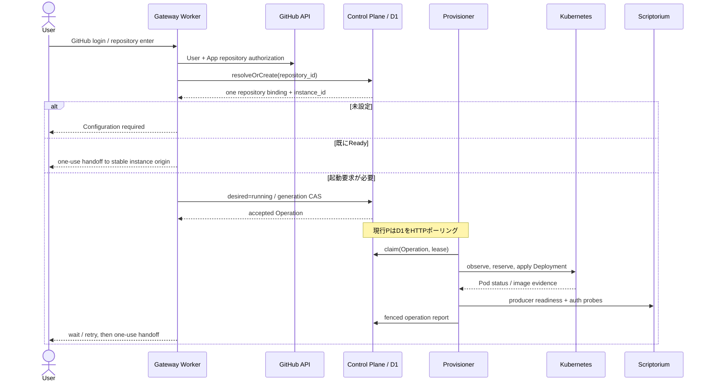
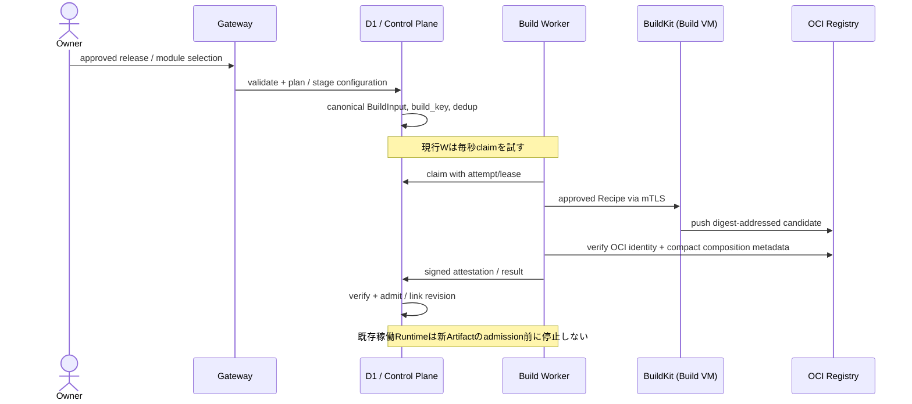

# Praetorium — エンドツーエンド経路・状態遷移・実行契機

> **種別:** LEGACY EXECUTION REFERENCE。旧実装経路・Polling例の台帳であり、現在の設計や稼働を規定しない。正規設計は[MANAGEMENT-PLANE.md](MANAGEMENT-PLANE.md)と[ADMINISTRATION.md](ADMINISTRATION.md)。実測・commitは[検証記録](../verification/README.md)に保存する。上位要件は[Epic #1](https://github.com/yohn-jp/praetorium/issues/1)。

旧コードの各経路について、**Trigger（なぜ発生するか）→ Authority（誰が決定するか）→ Effect（何を変更するか）→ Evidence（成功の根拠）**の順で記す。タイマーの存在自体を要求と解釈しない。

## 1. 認証・リポジトリ解決・初回起動



**契約:** GitHub numeric IDで同じリポジトリは常に同じ論理インスタンス。現在のユーザー権限を検査し、未構成なら起動しない。D1はDesired Stateを記録するだけで、Podを直接起動しない。

**現行実装:** `apps/gateway/src/services/portal-service.ts:293–415`、`apps/control-plane/src/worker.ts`、`packages/application/src/instances/instance-service.ts`。Provisionerは`apps/provisioner/src/worker.ts`からclaim。D1の単一性・CASは`0001_repository_platform.sql`とPersistenceに置く。

**受入の物証:** 実GitHub Appユーザー2名、同一Repository→同一Instance、権限のないユーザーへの拒否、Config未設定、既存Readyの再利用、同時起動時のWriter重複なし。

## 2. 停止中の直接URLと稼働中の本文ルーティング

```text
Browser → https://ins-<id>.<suffix> → public TLS/edge → Traefik
  /_platform/*                     → Instance Access (always)
  instance route priority=10        → Scriptorium (if current route is active)
  fallback priority=1               → Instance Access
```

`apps/instance-access/src/handler.ts:333–335,364–469`: 停止中のHTML navigationはGatewayの`/entry/<instance_id>`へ戻す。API/MCPは`503 INSTANCE_STARTING`と`Retry-After`で応答する。リクエスト本文を貯めたり勝手に再送したりしない。`/_platform/handoff`はone-use codeをGatewayへ確認し、Host-only HttpOnly Cookieを設定する。

`apps/gateway/src/router.ts:811–869`: 初回entryで権限を再確認し、起動待ちは5秒ごとの**回数制限付きブラウザリフレッシュ**で状態を再照会する。

`infrastructure/kubernetes/base/stopped-instance-fallback.yaml`と`plugins/kubernetes/src/kubernetes/renderer.ts`で静的fallbackと動的IngressRouteを分担する。**通常の編集本文はCloudflareを経由しない**。証明書の深いワイルドカードと公開edge到達性は別の外部条件であり、K3s内TLS証明書だけでは達成されない。

## 3. 構成変更・ビルド・Artifact Admission



- `plugins/scriptorium`がProducer Catalogからモジュールの依存・互換性を解決。任意のユーザーDockerfileを許可しない。
- `packages/application/src/configurations/service.ts`が`canonical BuildInput`を作る。`build_key = SHA256(canonical BuildInput)`はユーザー／リポジトリ情報を含まず、同じ承認済み構成で再利用可能。
- `packages/application/src/builds`がD1 Build記録、claim/lease/進捗/取消を扱う。`apps/build-worker`はK3s Pod、`plugins/buildkit`はBuild VMのrootless daemonに対するClient。
- `plugins/ghcr`は承認済みBuild InputとOCI Manifest／Platform／Digest、構成メタデータ、Builder署名の対応を確認する。信頼済みProducerがビルド中に確認したBrowser／Server closureと依存パッケージは再走査しない。実行適合性はk3sのReadiness／Canaryで確認する。`Artifact登録`と`RegistryにManifestがある`ことは別。
- Registryのpublish credential、アプリpull credential、GitHub App tokenは混ぜない。
- BuildKitのローカルGC目標、D1のBuildキャッシュ台帳、GHCRの実Blobは別々のオブジェクト。D1のGC「削除候補計画」はRegistryの削除を実施していない。

**現在の起動契機:** K3s Build Worker Podが`PRAETORIUM_BUILD_IDLE_DELAY_MS=1000`をデフォルトとして`/internal/builds/claim`へHTTP通信する。要求を発見するための仕組みであり、Buildを正当に実行する証拠ではない。実行時にのみLease更新（デフォルト15秒）が必要になる。

**受入の物証:** 承認済みScriptoriumの異なる2構成のOCI生成、未知モジュール／任意パッケージ・コマンド・Dockerfile指定の拒否、同一BuildKeyでの再利用、OCI Digest・Builder署名・Composition Manifestの対応、実Runtime Readiness／Canary、Build失敗時の既存サービス保持、秘密・作業データ混入なし。全rootfsの再取得は要求しない。

## 4. Runtime置換・再デプロイ・Writer保護

| 順序 | 所有する判断・証明 | 主体 |
| --- | --- | --- |
| 1 | D1のdesired revision、generation、runtime epoch、Artifact Admissionを確認 | Control Plane + Provisioner |
| 2 | 実クラスターのCapacityと予約を確認 | K8s Provider + D1 Reservation |
| 3 | 旧Scriptoriumにstatusとquiesceを要求。pending checkpoint、active job、uncertain publicationがない | Scriptorium + Provisioner |
| 4 | Git credentialの発行停止・既存credentialの退役と、旧Writer Podの**不在**を別々に証明 | Gateway broker + Provisioner + Kubernetes |
| 5 | ターゲットPodを起動し、実imageID・Repository・Epoch・Modules・Auth・Readyを確認 | Kubernetes + Scriptorium + Provisioner |
| 6 | ターゲットの安定origin routeを有効化し、D1へ確認済み観測結果を報告、以前の予約を解放 | Provisioner + Control Plane |

`packages/application/src/lifecycle/service.ts`、`apps/provisioner/src/lifecycle-executor.ts`、`plugins/kubernetes/src/kubernetes/provider.ts`が実行経路。

**区別:** KubernetesがクラッシュしたPodを再起動する通常の自己修復に、Cloudflareの周期ポーリングは不要。これに対し、**論理的なRuntime置換**では旧Writerが別途生存している可能性を無視できない。Operation Lease/期限切れはPod不存在やGitHubへのpush権限消滅の証明にならない。ここは複雑であっても初期安全要件に根拠がある。

`Runtime Epoch`を更新する`redeploy`は同じImage Digestでも別の実行世代。`restart`／`redeploy`／`update`を同一視しない。Compatible rollbackは実際のPersistence Read/Write契約と復旧状態を再検査する。

## 5. アイドル停止：現在の処理と本来の目的

**本来のTrigger:** 最後の有意な活動から15分経過、かつアクティブ要求・ジョブ・未保存作業がなく、安全に停止できると判定されたこと。監視プローブだけで活動時刻を延ばさない。

**現行の実際の呼び出しチェーン:**

1. `ProvisionerIdleController.run()`が60秒ごとに`/idle-candidates`をControl Planeへ要求。
2. Control PlaneがD1の`logical_instances`、`operations`、`runtime_reservations`を走査。候補ごとにRuntime割当を組み立てて返す。
3. ProvisionerがK8s Podをinspectし、必要なら5分有効のRuntime Identityを更新。
4. Control Planeへ**新しいStatus用Credential**を要求し、Scriptorium`status`を取得。
5. 条件が揃うと`authProbe.verifyObserved()`を呼ぶ。これは実UI/API/MCP/不正Grant拒否/永続性の検査であり、通常の「最後の活動」取得より重い。
6. `recordRuntimeHealth`でCloudflare D1に検証証拠を書き込む場合がある。
7. 15分超過かつ安全な場合だけ、`/idle-stop`経由でD1のDesired Stateを`stopped`へ変更し、停止Operationを作る。
8. ProvisionerのLifecycle Serviceが前節のQuiesce/Writerフェンスを通して停止。

コード: `apps/provisioner/src/idle-controller.ts:240–450`、`apps/control-plane/src/idle-routes.ts`、`apps/provisioner/src/scriptorium-control-client.ts`、`apps/provisioner/src/runtime-auth-probe.ts`。

**問題:** Idle期限の検知、Runtime Identityの更新、受入検査、D1のHealth証拠保存が一つの60秒ループに混在。後者の必要性が前者のポーリングを正当化するものではない。

**要件を満たす代替の境界（未決定）:** Scriptorium自身が活動・ジョブを把握し、ローカルVM側で期限到来を扱い、最終停止のCAS・Quiesce・Writer確認だけControl Plane/D1を通す。Pod/VM再起動後の期限復元、通知欠落の修復、Identity更新主体を明確にした上で選択する。D1の`idleDeadlineAt`のような列を新設するかどうかは**設計判断**であり、現行Schemaの事実ではない。

## 6. Runtime Identity とGitHub Credentialの更新

**別々の権限である。**

- Runtime Identity JWT: `apps/control-plane/src/runtime-identity-routes.ts`が現在のRepository/Instance/Epoch/Lease Bindingを確認し、最大300秒で発行。`apps/provisioner/src/runtime-identity.ts`は期限と60秒マージンで必要なとき再取得する。
- Tenant Podに投影するIdentity: `apps/provisioner/src/kubernetes-lifecycle-adapter.ts`は期限90秒前から更新を実施。短いループはLifecycle実行に結びつき、通常の長寿命インスタンスの更新経路はIdle Controllerにも依存している。
- GitHub Installation Token: `plugins/github/src/credential-broker.ts`／Gateway brokerが、その時点のRuntime BindingとGitHub user permissionを検証。`write`には新しいactor mutation receiptが必要。
- GatewayのBrowser Access Grant: 期限上限300秒、refresh/logoutは同一originのInstance Access経由。これらはユーザー操作に紐づく。

**設計論点:** Idleスキャンを廃止した結果、Runtime Identity更新まで止めてしまうのは誤り。一方、Identity更新が必要だからといって全インスタンスのD1候補走査やフルHosted受入検査を毎分行う理由はない。

## 7. Release / Stable / Pinned

**入口:** `POST /v1/operator/releases` は明示的なOperator Admission。署名・Registry・Producer Metadataを確認した候補だけをD1へ登録する（`apps/control-plane/src/releases/operator-admission.ts`）。

**現行の進行:** Cloudflare Cron（`*/5 * * * *`）が、D1上に**既に登録された**`release_candidates`をページ探索→昇格ワークフロー→CanaryのBuild/Runtime/Health Window→Stable更新→Follower Rolloutへ進める。外部レジストリの変更を毎回問い合わせる処理ではない。`packages/application/src/releases/discovery.ts`、`promotion.ts`、`rollouts/service.ts`が該当。

**必要な契約:** Operatorの承認、Canary結果、Stable更新とFollowerの順序、現在のリビジョンの一致を保持する。Pinnedを勝手に変更せず、意図的に停止しているインスタンスを自動で起動しない。

**未決定:** D1登録時に何を実行し、Canaryの10分健康観測・延期・再試行をどこが期限付きで起動するか。Cronを必須とせず、期限状態とトリガーを別々に定義する。

## 8. Control Plane Cron と補償処理

`apps/control-plane/src/worker.ts:309–315`、`apps/control-plane/src/scheduled.ts`の現行5分周期には次が結合している。

| 処理 | データ/副作用 | 本来のTrigger（分析） |
| --- | --- | --- |
| `runtime_git_credentials`期限切れ削除 | D1の不要レコードを一定数削除 | 保持期限・明示的な退役・低頻度回収 |
| Build cacheの`planCacheMaintenance` | D1のsnapshot read、advisory-only計画を**監査INSERT**。OCI Blob削除ではない | 予算超過・参照変更・Operator保守の必要時 |
| Release探索・Promotion・Rollout進行 | D1上のワークフローCAS、場合により新規Build/Runtime操作 | Operator Admission、前工程結果、Canary期限、失敗後のretryAt |

現行では`RELEASE_POLICY_JSON`未設定で`throw`し、Cron全体が失敗する。未設定の任意のRelease機能が他の保守処理の継続に影響する設計がある。変更方針は[REVIEW.md](REVIEW.md)で判断する。

## 9. 常時通信と請求対象の区別

**月30日＝2,592,000秒、各プロセスが常時起動・正常に空振りし続ける仮定。** 以下はコードのデフォルト間隔から計算した理論上のHTTP呼び出し回数であり、実トラフィック・D1行課金・請求金額の実測ではない。

| 呼び出し | 実装間隔 | 30日あたりの理論上の回数／1プロセス | Cloudflare境界 |
| --- | --- | ---: | --- |
| Provisioner `claimNext` | 2秒 | 1,296,000 | Cloudflare Control Plane HTTP |
| Build Worker `claimNext` | 1秒（`PRAETORIUM_BUILD_IDLE_DELAY_MS`既定） | 2,592,000 | Cloudflare Control Plane HTTP |
| Idle Controller `listIdleCandidates` | 60秒 | 最大43,200回の走査試行 + 候補別API | Cloudflare Control Plane HTTP／D1 |
| Control Plane Cron | 5分 | 8,640回の起動 | Cloudflare scheduled event／D1 |
| Operation/Build Lease更新 | **処理中のみ**、通常10/15秒 | 仕事の実行時間に依存 | Cloudflare Control Plane HTTP |
| Browser refresh / Git credential / Gateway authorization | **ユーザー操作・使用時** | 操作量に依存 | Cloudflare Workers/DO/KV/GitHub |
| K8s PodのlivenessとVM内Disk監視 | Kubernetes／VMのローカル間隔 | Cloudflareの直接リクエストとは限らない | 原則ローカル |

空振り3系統の単純合計は3,931,200回/月（1 Provisioner + 1 Build Worker + 1 Idle Controller）。実際の処理時間、エラー時のbackoff、Service数、候補別の追加呼び出しで変わる。**高額請求になるとの断定も、無視できるとの断定もできない**。本番の請求額を論じるにはWorkersリクエスト/CPU、DO実行、D1行読み書きの実測が必要。

ローカルK3s/VMを常駐させること自体はCloudflareへの通信を必然化しない。「常駐しているからCloudflareをポーリングする」は理由にならない。

## 10. 復旧・観測と必要な受入物証

| 事象 | 誰が収束するか | 真に必要な照合 |
| --- | --- | --- |
| Podがクラッシュ | Kubernetes Deployment Controller | 生存/Ready、自動再起動。Cloudflareの死活監視は不要 |
| Provisioner再起動／処理途中で失敗 | Provisioner + D1 Operation | 現在のclaim/lease、永続Checkpoint、実Writer censusを再検査 |
| Build Worker再起動／途中キャンセル | Build Worker + D1 Build Attempt | Lease epoch/attempt/成果物Digest、取消・再試行の安全性 |
| 停止中URLへのアクセス | Traefik fallback + Instance Access + Gateway | GitHub user権限、Repo Binding、許可されたWake |
| D1/APIが利用不可 | 状態変更はfail-closed、Kubernetesのローカル自己修復は継続可能 | 新しい許可なしの置換/削除をしない。既存編集・Git保存の継続可否は未実証 |
| Cloudflareへの通知が失われた | 将来の通知機構＋明示的な再同期 | D1と実K8sの境界、世代、旧Writer不在を保持 |
| 未公開原稿が残る | Scriptorium + Browser recovery | 新規停止/置換はブロック。GitHub confirmed commitと別に扱う |

**物証の基準:** 実ユーザー/実GitHub App・Repo、実Scriptoriumイメージ、Registry admission、実K8s/Ingress、Browser UI/API/MCP、変更・保存、pending checkpoint時の停止拒否、stopped direct-origin wake、再起動、writerフェンス、Stable/Pinned Rollout。`pnpm check`、Unit fixtureやホストBusyBoxの構築成功だけではHosted合格にならない。

最新の保存済み総合レポート`docs/verification/HOSTED-ACCEPTANCE-a669f5c.json`では`workers-d1-do`以外の主要Hostedカテゴリが`BLOCKED/NOT_CHECKED`。Ubuntu 26.04のホスト受入は別に成功している。現行mainの実Hosted完走を示す新しい証拠は、この照合では確認していない。

## 11. コード変更時に守る分離原則

1. **通知 ≠ 実行権限。** 通知を使う場合もD1のclaim/CAS/Lease/Artifact Admissionを省略しない。
2. **タイマー ≠ 停止許可。** ScriptoriumのIdle期限に達しても、Quiesce/Writer absence/未公開作業の確認は必要。
3. **K8sのReady ≠ 作業永続化済み。** Podの自己修復と論理的なライフサイクル更新は別。
4. **D1のobserved state ≠ Kubernetesの現在の真実。** 破壊的操作前は新しい実物証拠を要求。
5. **Producerの自己申告Digest ≠ Registry／CRIの実イメージ証明。** 同一Manifestの実検証を維持する。
6. **Cloudflareへの通信頻度 ≠ 要件。** 初期Epicの動作・安全・回復条件を満たせるなら、実行契機の再設計を妨げない。
