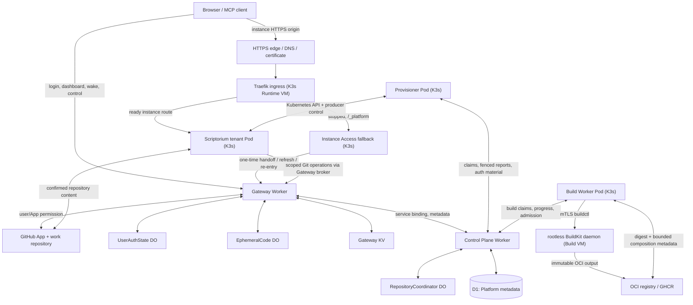

# Praetorium — システム全体像と責務境界

> **種別:** **2026-10-18のコードに基づく歴史的主体・正本台帳**。下記の旧Topologyとタイマーは現在の実機Topologyを表すものではない。
> **元のコード照合:** `ecabf265693e395c40bfcf9be8279c1baf4740ff`（2026-10-18）。**2026-10-24の変更設計のcut:** [main@1930131e](https://github.com/yohn-jp/praetorium/tree/1930131e6858e5d9035abe1dcd82d4ae654c622d)。要件正本は[初期Epic #1](https://github.com/yohn-jp/praetorium/issues/1)と最新の明示的オーナー指示（CI許可）。
> **現行構成と目標:** [MANAGEMENT-PLANE.md](MANAGEMENT-PLANE.md)（実施済み3VMを反映）、[ADMINISTRATION.md](ADMINISTRATION.md)（独立Admin Worker＋横断監視の確定目標）、[THREE-VM-INFRA.md](../verification/THREE-VM-INFRA.md)（2026-10-20の新規Bootstrap実測）、[移行残ゲート](MANAGEMENT-PLANE-MIGRATION.md)。旧経路のコード調査には[EXECUTION.md](EXECUTION.md)、旧監査には[REVIEW.md](REVIEW.md)。
> **読み方:** 以下の旧Actor表は権限・D1/K8sの正本を追跡するため残したもの。既存コードの説明を「承認済み完成形」や「現在の稼働」に読み替えない。本書だけで本番変更・公開は許可されない。

## 現行3VMの観測とAdmin分離の目標（更新：2026-10-24）

| 対象 | 記録された実装・実機事実 | 固定したあるべき境界 |
| --- | --- | --- |
| Management | 2026-10-20の新規Bootstrapでホストk3s Server・rootless Coordination/Tunnel稼働、再起動後の復帰を観測 | k3s Server、VM横断read-only観測。Adminの状態正本は作らない |
| Runtime | 同Bootstrapでk3s Agent・Scriptorium Pod稼働を観測 | Runtime Workload/Ingress、実Pod観測はKubernetesが正本 |
| Builder | 独立rootless BuildKit、cgroup/cacheの時点観測あり | OCI生成・Cache。管理VMやAdminへBuild実行権限を渡さない |
| Cloudflare Gateway | 2026-10-24 mainでは `apps/gateway` がGateway/Admin両OriginとAdmin UI/sessionを含む | GatewayはGitHub OAuth/Session正本を保持、Adminは別Workerへ分離 |
| Cloudflare Control Plane | D1がBuild/Operation/Release等の正本、既存Operator Admissionを持つ | 同じD1/契約のままAdminのOperator入口に限定権限を渡す |
| Admin Plane | 独立Worker・VM統合監視は未実装 | `admin.praetorium.yohn.jp` 独立Worker、Gatewayの非公開Identity Broker、Management read-only Observer |

**観測事実は2026-10-20の時点記録であり、いまも稼働中であることのライブ証明ではない。** Host bootstrapの完成はHosted製品のG1–G9合格でもない。以下の旧トポロジー図は移行前の説明として保持する。

## 1. 製品が提供するもの

Praetoriumは、GitHubの現在の権限に従ってユーザーを**リポジトリ単位の一つの論理的なScriptoriumインスタンス**に接続する。承認されたScriptorium本体・アドオンから不変のOCIイメージを組成・再利用し、起動・アクセス・更新・アイドル停止・安全な再開を扱うプラットフォームである。

ここでの目的は「Cloudflareがコンテナを監視すること」ではない。Cloudflare側が保持するのは**アカウント認可と論理的な設定・操作の正本**であり、Kubernetesが保持するのは**コンテナの実行状態**である。Scriptoriumは実際の作業と安全な静止点を把握する。

初期契約から外せない境界:

- GitHub numeric `repository_id` → 一つの`instance_id`。ユーザー別のインスタンス・独立ACLを作らない。
- GitHubの作業リポジトリが確認済み成果の正本。未push、保留中のcheckpoint、ブラウザ復旧データは「既に永続化済み」と推定しない。
- アプリケーションのUI/API/MCP本文を一般のCloudflare Workers経由で中継しない。稼働中は安定したインスタンスHTTPS originへ直接接続する。
- 承認済みBuild Catalog・Recipe・Digest・署名・Compositionだけを採用し、テナント情報や仕事データを共有ビルドへ混ぜない。
- 更新・停止前にScriptoriumの`quiesce`と旧Writerの実在確認を行う。**リースの失効はWriter死亡の証拠ではない**。
- StableとPinnedの区別、リポジトリ権限の再確認、復旧可能性、操作・監査記録を保つ。
- デプロイ可能、ローカル統合検証済み、本番適用済みを混同しない。

初期Epicでは汎用PaaS、任意Dockerfile、任意プラグイン市場、新しい執筆/NLP機能、Billing、マルチクラスタHAを対象外としている。

## 2. 旧トポロジー（2026-10-18コードスナップショット：現行3VM図ではない）

**矢印は経路の概念図**であり、通信が常時必要という意味ではない。現行の起動契機・頻度と是正候補は[EXECUTION.md](EXECUTION.md)を参照。

**以下は2026-10-18の旧配置であり、2026-10-20の実機構成ではない。** 配置は当時、次のとおりだった。

- **Cloudflare:** Gateway Worker / Control Plane Worker / Durable Objects / KV / D1。CloudflareはScriptorium Podを直接起動・再起動しない。
- **Runtime VM:** Ubuntu 26.04 + K3s、Kubernetes Controller、Traefik、Instance Access、Provisioner、Build Worker、各Scriptorium Pod、観測サービス。
- **Build VM:** Ubuntu 26.04、rootless BuildKit、BuildKit用キャッシュ、外向きプロキシ、ディスク監視。Runtime管理用のKubernetes権限を持たない。
- **外部:** GitHub App APIと作業リポジトリ、OCIレジストリ、HTTPSの公開到達性・証明書終端。
- **CI:** GitHub Actionsの検証は許可。タグによるイメージ**公開**や本番適用は、単なるCI許可とは区別する。

ホスト検証の物証は[Ubuntu 26.04実機記録](../verification/UBUNTU-2604-20261017.md)。そこで確認されたのはホストと汎用OCIビルドまでであり、Hosted製品のE2Eではない。

## 3. 主体と責務：Cloudflare側

> Rate Limiting APIへの移行は[PR #14](https://github.com/yohn-jp/praetorium/pull/14)の変更であり、本番デプロイ済みを意味しない。WAF設定はオーナーの別作業。

| 主体・コード | 何のためにあるか／所有する状態 | 実行する操作 | **所有しない責務** |
| --- | --- | --- | --- |
| **Gateway Worker** `apps/gateway` | ユーザーセッションの入口、GitHub権限に基づくGrant発行・交換、管理UI/API、Git認証仲介 | OAuth、権限再確認、リポジトリ選択、D1操作要求、one-use handoff、refresh/logout、GitHub Appトークン仲介 | Scriptoriumの本文中継、Pod死活監視、BuildKit起動 |
| **Control Plane Worker** `apps/control-plane` | D1の状態変更を扱うAPI、論理インスタンス、構成、Build/Artifact/Operation/Releaseの受入と検証 | CAS/冪等操作の受付、claim/heartbeat/report、署名/権限・ポリシー評価、必要な状態遷移の確定 | コンテナのLiveness/Readinessを常時測ること、GitHubの作業本文、BuildKitでのビルド実行 |
| **RepositoryCoordinator DO** `apps/control-plane/src/worker.ts` | 同じGitHubリポジトリに対する一部の変更要求を直列化する**実行中のPromiseキュー** | `repository_id`でシャーディングし、対象APIを順序づける | Desired Stateの永続保存。**このDOに別の状態正本はない**（D1 CASが必要） |
| **UserAuthState DO** `apps/gateway/src/adapters/durable-objects` | ユーザーごとのセッション、MCP認証情報、暗号化されたGitHubユーザートークンとrefreshロック | 保存・検証・失効・トークン更新の直列化／トランザクション | GitHubリポジトリ権限自体の決定、インスタンスのDesired State |
| **EphemeralCode DO** 同上 | OAuth login attempt、one-use handoff、同一originのrefresh credential | 原子的な消費・交換・ローテーション・失効。コードは32シャードへ分配 | ユーザーのGitHub権限やRuntime状態の正本 |
| **Gateway KV** `key-registry-kv.ts`／`digest-user-index.ts` | 公開JWKレジストリ、セッション／credential digest→userの**ルーティングヒント**のみ | 公開鍵・インデックス参照。レート制限カウンターは保存しない | 認可セッションの正本、レート制限のread-modify-write |
| **Workers Rate Limiting API** `rate-limiter-workers.ts` | Login、MCP入力源／credential、Runtime Git、Wake、Mutationの濫用抑制 | Cloudflare公式Bindingによるlocation-localな近似的制限 | グローバルな課金・同時実行上限、権限判定、D1/CAS／single writerの保証 |
| **D1** `apps/control-plane/migrations`／`packages/persistence/src/d1` | インスタンス・構成・Release・Build・Artifact・Operation・Lease・Reservation・監査の**永続的な論理正本** | 世代/リビジョン比較、claimとreportの整合性維持、再試行時の復元 | Podの真の実行状態、ファイル実体、GitHub上の原稿、BuildKitキャッシュの実体 |
| **Workers Cron** `apps/control-plane/src/worker.ts` | 現行は5分ごとの保守・リリース進行の**起動契機** | 期限切れCredential削除、D1キャッシュ計画、Release候補探索・昇格・Rollout進行 | それ自体は永続状態の正本でも、K8sコンテナ監視主体でもない |

**D1・DO・KVを混同しない。** D1は論理状態の正本、DOは特定キーの排他／Gatewayセッションの局所ストレージ、KVは公開情報・ルーティングヒント。HTTP濫用抑制はWorkers公式Rate Limiting APIであり、厳密なグローバル上限ではない。`RepositoryCoordinator DO`の存在を理由にD1の世代チェックを省略してはならない。逆に、DOの追加が本当に必要かは[レビュー項目](REVIEW.md)として未決定である。

## 4. 主体と責務：VM・Kubernetes・外部

| 主体・コード | 何を所有・観測するか | 実行する操作 | **所有しない責務** |
| --- | --- | --- | --- |
| **K3s/Kubernetes** | Pod、Deployment、Service、Secret、Namespace、実際のリソース状態とNode Capacity | スケジューリング、Livenessによる再起動、Ready条件、宣言したreplica数への収束 | GitHubユーザー認可、未保存原稿の判定、リリースの承認 |
| **Provisioner Pod** `apps/provisioner` | D1の承認済みOperationをK8sへ反映する実行権限（期限付）、Lifecycle Journal、旧Writer不在の証拠 | K8s Providerによる起動・停止・route切替、Quiesce、Writer census、Capacity予約、結果報告 | D1とは独立したDesired Stateの決定、すべてのPodの常時死活監視 |
| **Kubernetes Provider** `plugins/kubernetes` | K8s APIの具体的なリソース、実Pod/imageID、Node/Pod Capacity | 動的リソースのrender・inspect・conditional apply・scale・cleanup。実施前にOwnershipとEpoch確認 | ユーザーの設定画面やリリース承認 |
| **Traefik** `infrastructure/kubernetes` | 安定インスタンスoriginのHTTPルーティング | `/_platform/*`をInstance Accessへ、Readyな個別originをScriptoriumへ、停止中はfallbackへ | OAuth判定、ユーザー／アプリケーション本文の永続保存 |
| **Instance Access Pod** `apps/instance-access` | 停止中でも存在する同一originの入口。Cookieの配置・更新 | one-use handoffのGateway照会、refresh/logout、未起動時のredirectまたは`INSTANCE_STARTING`応答 | 変更リクエストの本文のバッファ・再送、K8s操作、第二のユーザー認可データベース |
| **Scriptorium Pod** （別リポジトリ） | 執筆UI/API/MCP、プロジェクト内容、活動・実行中ジョブ、pending checkpoint、公開状態、Quiesceの安全性 | 原稿編集、Git fetch/commit/push、Activity/Status/Quiesce/Resume、Grant検証 | 他リポジトリの状態・Platform全体のDesired State、他テナントのBuild |
| **Build Worker Pod** `apps/build-worker` | 許可されたBuildInput、attempt、lease、進捗、検証結果 | Build claim→BuildKitへ実行依頼→OCI検証・署名・結果報告 | Runtime K8s admin、任意Dockerfile、Work Repository token |
| **BuildKit daemon（Build VM）** | ローカル実行環境・OCIビルドキャッシュ | rootlessで承認済みRecipeを実行、OCIアーティファクトの出力 | GitHub権限、D1 Desired State、Scriptoriumの作業 |
| **OCI Registry/GHCR** | Digestで参照する不変OCIデータ（Runtime Base / Build Kit / Composed Image） | Artifactのpull/push/manifest/blob保存 | Admissionの可否を決める権威、原稿やセッション状態 |
| **Scriptorium Producer Catalog** `plugins/scriptorium`による消費 | 承認済みモジュール・依存関係・Recipe/Runtime Metadata | モジュール組成規則と元データを提供。Praetoriumは版・digestの一致を検証 | D1のinstanceを直接変更 |
| **GitHub App / GitHub Repository** | ユーザー・リポジトリの現行権限、確認済みGit履歴 | ユーザートークン・Installation Token発行、clone/fetch/承認済みpush | Platformの操作キュー、Buildの承認 |
| **Flux / Helm controllers** | 静的K8sコントローラ・HelmReleaseなどのGitOpsリソース | 宣言された静的プラットフォーム構成の同期（現行の適用責務には曖昧さあり） | Provisionerが動的に作るテナントRuntimeの所有 |
| **cert-manager / TLS edge** | 内部K8s証明書と公開HTTPS到達性（異なる境界） | K8s証明書管理／公開入口の証明書終端 | 公開Cloudflare Edge証明書の要件をK8s証明書だけで解決すること |
| **Prometheus / Logs** | 計測・監査の観測結果 | 構成されたメトリクス収集 | Desired Stateや認可の正本 |
| **Ubuntu/systemd／Build VMのDisk監視** | VM起動、BuildKitサービス、ext4空き容量・GC閾値 | サービス再起動、容量監視。現行ホスト検証では8GiB GC目標／2GiB空き監視 | OCI Artifactの承認、Scriptoriumの保存判定 |
| **Legacy recovery CLI** `plugins/legacy-recovery` | 旧Arcadiaデータ移行・バックアップ復旧の明示的な管理操作 | オフラインExport/Restoreと検証 | 通常のRuntime停止時に古いPVCやユーザーデータを削除すること |

## 5. 状態の正本（データ別）

「Cloudflareが正本」のような単位では不十分。**状態ごとに正本を一つに定める。**

| 状態・データ | 正本 / 保持先 | 派生情報・更新主体 |
| --- | --- | --- |
| GitHubのユーザー・Repository permission | **GitHub** | Gatewayがアクセスごとに必要な再検証を行う。App installだけではユーザー権限にならない |
| 確認済み原稿・Git履歴 | **GitHub work repository** | Scriptoriumの作業状態やローカルGit cloneは別。未pushデータの安全性は別途検証 |
| ブラウザの未送信変更 | **利用中のブラウザ／Scriptoriumの復旧契約** | PlatformはIndexedDBの中身を読めない。Pod停止が安全とは推定しない |
| ログイン/MCP credential、OAuth attempt、handoff/refresh | **GatewayのDO** | KV digest indexは探索用ヒントであり正本ではない |
| RepositoryBinding／LogicalInstance（`desired_state`、`generation`、`runtime_epoch`、`policy`） | **D1** | Gatewayが認可、Control PlaneがCASで確定 |
| observed_state／observed_epoch／Health evidence | **D1の永続スナップショット** | 観測元の実体はKubernetes/Scriptorium。D1スナップショットを生存証明に使わない |
| BuildInput、Build attempt、lease、operation checkpoint | **D1** | Build Worker／Provisionerがclaim・report。DOのPromiseキューは正本ではない |
| Artifactの承認状態、Build cache key/index | **D1** | OCI実体はGHCR、BuildKitのローカルキャッシュとは異なる |
| OCI manifest/Blob | **OCI Registry** | D1のDigest参照だけでblobの存在・署名・可用性を保証しない |
| Runtimeで動いているPod、imageID、Service/Route、Node Capacity | **Kubernetes API（観測対象の実体）** | Provisionerが認証済みOperationに従って変える。通常のPod再起動はK8sが実施 |
| Runtime identity/JWT、Repository Git credential | **Control Planeの現在のbinding/epoch + Gateway brokerの検証** | JWTは短寿命。発行済みトークンが永続ロックの代替にならない |
| Stable candidate／Canary／Promotion／Follower Rollout | **D1** | 実行や観測はBuild Worker・Provisioner・Scriptoriumが担当 |
| GitOpsで管理する静的リソース | **承認済みGit revision / Inventory** | K8sの実物をFlux/適用ツールが反映。現行の適用責務は[要整理](REVIEW.md) |

D1の実テーブル: `logical_instances`、`repository_bindings`、`operations`、`runtime_reservations`、`cluster_capacity_snapshots`、`builds`、`build_attempts`、`artifacts`、`deployment_revisions`、`audit_events`、`staged_configurations`、`release_candidates`、`stable_release_channels`、`release_candidate_workflows`、`stable_rollouts`、`runtime_git_credentials`、`runtime_health_observations` など。定義は[マイグレーション0001–0005](../../apps/control-plane/migrations/)が真の実装根拠。

## 6. 内部の階層構造と境界ルール

| 層 | 役割 | パス |
| --- | --- | --- |
| `apps/` | 実行プロセスとHTTP/Workerの組み立て、入口 | `gateway`、`control-plane`、`instance-access`、`provisioner`、`build-worker` |
| `packages/contracts` | 言語に中立なワイヤSchemaと検証契約 | `packages/contracts/src/*` |
| `packages/domain` | ID・不変条件 | `packages/domain/src/*` |
| `packages/application` | 操作・設定・build・release・lifecycleのユースケース | `packages/application/src/*` |
| `packages/auth` | 認証/Grant/セッションの純粋な契約と暗号処理 | `packages/auth/src/*` |
| `packages/persistence` | D1のSQL実装 | `packages/persistence/src/d1/*` |
| `plugins/` | GitHub、GHCR、BuildKit、Kubernetes、Scriptorium、旧データ復旧の具体的Adapter | `plugins/*` |
| `infrastructure/`、`scripts/` | 静的リソース、Inventory、ホスト構築、デプロイ、ゲート | `infrastructure/*`、`scripts/*` |

実装のimport境界チェッカーは`packages/domain`、`application`、`contracts`がProvider具体実装を直接importしないことを確認する（`scripts/check-boundaries.mjs`）。ただし「import違反がない」ことは「責務分離が正しい」ことの証明ではない。

## 7. 外部権限と失敗境界

- **Browser → Gateway:** GitHub user権限 + Portal session + CSRF。Repository単位の意図を受け付ける。
- **Gateway → Control Plane:** 内部Service Bindingとサービス認証。最終的な状態変更はD1のCAS／世代検証を通る。
- **Instance Access → Gateway:** Handoff/Refresh/Logoutのみ。通常の原稿本文は中継しない。
- **Provisioner → Control Plane:** 専用サービスcredentialと実行中Operation lease。K8s管理権限はProvisioner側だけに置く。
- **Build Worker → Control Plane/BuildKit/Registry:** Build claim、mTLS、必要なregistry credential。K8s Runtime管理権限を持たない。
- **Scriptorium → GitHub:** 固定App鍵ではなく、repository/instance/epochに拘束したbroker-issued短寿命credential。writeは現在のactorの承認が追加で必要。
- **Scriptorium → Platform:** バインドされたRuntime identityおよび管理専用の短寿命証明。テナントから他テナントの状態へ直接アクセスさせない。

Cloudflareが一時的に不通でもKubernetes自体はPodの再起動を行える。ただしGitHubへの新たなbrokered credential発行・起動要求・セッション更新の可否は別問題であり、**オフライン時に執筆継続できることは現時点で実証済み要件としない**。

## 8. 実装事実と未確定の設計を分ける

この文書は「今何が実装されているか」を配置・責務に投影したもの。以下は仕様として確定していない。

- Provisionerの仕事発見を、常時HTTP claimからどの通知・補償方式へ変えるか。
- Build Workerの空振りclaimをどうなくすか。
- ScriptoriumのIdle期限の保管・再起動後復元を誰が持ち、期限到来時だけどのようにD1へ停止を要求するか。
- Runtime identity（5分上限）の更新をIdleスキャンからどう分離するか。
- RepositoryCoordinator DOがD1 CASの上で必須か、必要な対象ルートが適切か。
- Static DeploymentをFluxと`kubectl apply`のどちらが最終的に所有するか。
- Release candidateの承認・canary監視・自動昇格をどの実行契機で進めるか。

これらを既存コードから「正解」として転記せず、[REVIEW.md](REVIEW.md)に差分・根拠・決定事項として分ける。**初期Epicの受入条件と異なる新要件を、この文書だけで増やさない。**
